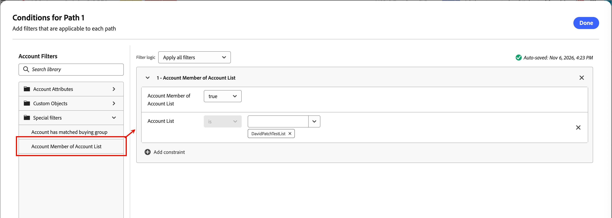

# Usar listas de contas no jornada

Há várias maneiras de incorporar listas de contas Ativas (publicadas) nas jornadas de conta.

## Nó de público-alvo da conta

Todas as jornadas de conta começam com um nó [_Audiência da conta_](../journeys/account-audience-nodes.md). Quando você define este nó para usar uma lista de contas, as contas do membro se movem pela jornada quando ela fica ativa (publicada).

1. Selecione a opção **[!UICONTROL Lista de contas]** para o nó _Público-alvo da conta_ inicial.

   {width="500"}

1. Clique em **[!UICONTROL Adicionar lista de contas]**.

1. Marque a caixa de seleção da lista de contas e clique em **[!UICONTROL Salvar]**.

   {width="600" zoomable="yes"}

## Executar um nó de ação - Adicionar à conta

**_Somente listas de contas estáticas_**

Em uma jornada de conta, adicione contas a uma lista de contas estática usando o nó [a _Realizar uma Ação_](../journeys/action-nodes.md).

Por exemplo, você tem um caminho de jornada para enviar um email e algumas contas realizam várias ações como resposta. Você considera essa atividade um ponto de qualificação na jornada. Com a qualificação, você deseja adicioná-las a uma lista de contas usada como público-alvo para outra jornada com um fluxo diferente para contas qualificadas.

>[!NOTE]
>
>Se uma conta já estiver na lista quando o nó for executado, a ação será ignorada.

1. Selecione a opção _[!UICONTROL Ação em]_ **[!UICONTROL Contas]**.

1. Para _[!UICONTROL Ação nas contas]_, escolha **[!UICONTROL Adicionar à lista de contas]**.

   {width="500"}

1. Para **[!UICONTROL Selecionar lista de contas estáticas em tempo real]**, escolha a lista de contas à qual deseja adicionar contas.

   {width="500"}

## Executar um nó de ação - Remover da conta

**_Somente listas de contas estáticas_**

Em uma jornada de conta, remova contas de uma lista de contas estáticas usando o nó [a _Realizar uma Ação_](../journeys/action-nodes.md).

Por exemplo, você tem um caminho de jornada para enviar um email e algumas contas realizam várias ações como resposta. Você considera essa atividade um ponto de qualificação na jornada. Com essa qualificação, você deseja removê-los de uma lista de contas. Essa lista é usada como público-alvo de outra jornada que envia emails adicionais para que você não duplique suas comunicações de qualificação.

>[!NOTE]
>
>Se uma conta não estiver na lista onde está agendada para remoção, a ação será ignorada.

1. Selecione a opção _[!UICONTROL Ação em]_ **[!UICONTROL Contas]**.

1. Para _[!UICONTROL Ação em contas]_, escolha **[!UICONTROL Remover da lista de contas]**.

   {width="500"}

1. Para **[!UICONTROL Selecionar lista de contas estáticas em tempo real]**, escolha a lista de contas para a qual deseja remover as contas.

   {width="500"}

## Nó de caminhos divididos - Membro da conta da lista de contas {#split-paths-account-member-of-account-list}

**_Somente jornadas da conta_**

Use o filtro _[!UICONTROL Membro da Conta da Lista de Contas]_ em um nó [_Caminhos divididos_](../journeys/split-merge-paths-nodes.md#add-a-split-path-by-account-node) que se divide por contas. A conta é ou não é membro de uma ou mais listas de contas selecionadas. Para incluir contas nas listas, defina a associação como `true` ou defina-a como `false` para excluí-las.

Para excluir contas em uma inclui na lista de bloqueios, adicione o filtro _[!UICONTROL Membro da Conta da Lista de Contas]_, defina a associação como `false` e selecione a lista.

1. Navegue até o mapa de jornadas.

1. Clique no ícone de adição ( **+** ) em um caminho e escolha **[!UICONTROL Dividir caminhos]**.

1. Nas propriedades do nó à direita, escolha **[!UICONTROL Contas]** para a divisão.

1. Para definir uma condição para _[!UICONTROL Caminho 1]_, clique em **[!UICONTROL Aplicar condição]**.

1. Defina o filtro da lista de contas.

   * No editor de condições, expanda a pasta _[!UICONTROL Filtros especiais]_ e arraste o filtro **[!UICONTROL Membro da Conta da Lista de Contas]** para o espaço de trabalho de condições.

   * Para incluir contas nas listas, defina a associação como `true` ou defina-a como `false` para excluí-las.

   * Selecione uma ou mais listas de contas.

   {width="700" zoomable="yes"}

   Você pode combinar o filtro de associação da lista de contas com outros filtros de conta e escolher corresponder todas as condições ou qualquer condição. Refine suas condições aplicando a **[!UICONTROL lógica de Filtro]** na parte superior.

1. Clique em **[!UICONTROL Concluído]**.

Continue a configurar o nó do caminho dividido conforme descrito em [Adicionar um caminho dividido pelo nó de conta](../journeys/split-merge-paths-nodes.md#add-a-split-path-by-account-node).

## Nó de caminhos divididos - Membro pessoal da lista de contas {#split-paths-member-of-account-list}

**_Somente jornadas de pessoas_**

Use os filtros de associação da lista de contas em um [_nó de caminhos divididos_](../journeys/split-merge-paths-nodes.md) de uma jornada de pessoas para encaminhar pessoas com base no fato de a conta ser ou não membro de uma lista de contas. Dois filtros estão disponíveis:

| Filtro | Descrição |
| ------ | ----------- |
| [!UICONTROL Membro da Pessoa da Lista Dinâmica da Conta] | A conta da pessoa é ou não membro de uma ou mais listas de contas dinâmicas. |
| [!UICONTROL Lista Estática de Membro de Conta] | A conta da pessoa é ou não é membro de uma ou mais listas de contas estáticas. |

Para excluir pessoas em contas personalizadas de um caminho de criação, adicione o filtro _[!UICONTROL Membro de pessoa da lista estática de conta]_, defina o operador como `is not` e selecione a lista.

1. Navegue até o mapa de jornadas.

1. Clique no ícone de adição ( **+** ) em um caminho e escolha **[!UICONTROL Dividir caminhos]**.

1. Para definir uma condição para _[!UICONTROL Caminho 1]_, clique em **[!UICONTROL Aplicar condição]**.

1. Definir o filtro da lista de contas

   * No editor de condições, expanda a pasta _[!UICONTROL Filtros especiais]_ e arraste o filtro **[!UICONTROL Membro de Pessoa da Lista Dinâmica de Conta]** ou **[!UICONTROL Membro de Pessoa da Lista Estática de Conta]** para o espaço de trabalho de condições.

   * Para incluir as pessoas cuja conta está na lista, defina o operador como `is` ou defina-o como `is not` para excluí-las.

   * Selecione uma ou mais listas de contas.

     {width="700" zoomable="yes"}

   Você pode combinar filtros de associação da lista de contas com outros filtros de pessoas e escolher corresponder todas as condições ou qualquer condição. Refine suas condições aplicando a **[!UICONTROL lógica de Filtro]** na parte superior.

1. Clique em **[!UICONTROL Concluído]**.

Continue a configurar o nó do caminho dividido conforme descrito em [Adicionar um caminho dividido pelo nó de pessoas](../journeys/split-merge-paths-nodes.md#add-a-split-path-by-people-node).
