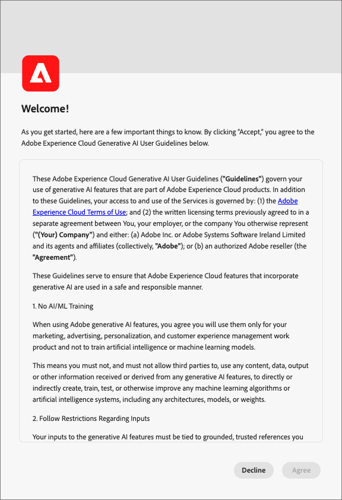
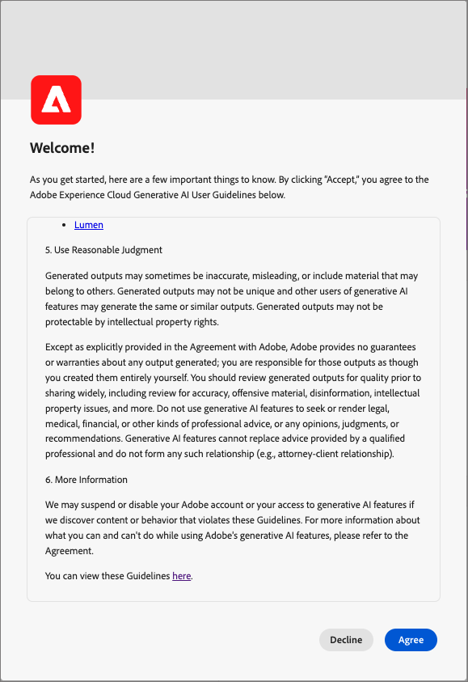

# Recursos de IA no Journey Optimizer B2B Edition

Use os recursos de IA do [!DNL Adobe Journey Optimizer B2B Edition] para gerar conteúdo, explorar o conhecimento do produto e obter insights operacionais.

>[!IMPORTANT]
>
>É necessário um contrato com as [diretrizes de usuário](https://www.adobe.com/br/legal/licenses-terms/adobe-gen-ai-user-guidelines.html){target="_blank"} para que você possa usar os recursos de IA no [!DNL Journey Optimizer B2B Edition]. Este contrato também contém o contrato público beta para que você possa usar recursos adicionais habilitados para IA durante a implantação.

+++Exibir a interface do contrato do usuário

+++

## Usar o aplicativo [!DNL Coworker] {#coworker-app}

Use a interface do aplicativo [!DNL CX Enterprise Coworker] para todos os fluxos de trabalho do chat diferentes da geração de conteúdo. Faça perguntas sobre o produto, explore insights operacionais e use [habilidades de jornada](../agents/journey-agent.md) e [habilidades de público-alvo para contas B2B e pessoas](../agents/audience-agent-b2b.md). A geração de conteúdo permanece disponível em [!DNL Journey Optimizer B2B Edition].

Para obter instruções sobre como abrir o aplicativo, iniciar conversas e usar recursos de chat, consulte o [guia de interface do CX Coworker](https://experienceleague.adobe.com/en/docs/coworker/content/chat/ui-guide){target="_blank"}.

Considere qual tipo de consulta você precisa antes de enviar uma consulta de chat do [!DNL Coworker].

### Conhecimento do produto

O conhecimento do produto refere-se a conceitos e tópicos baseados na documentação do [!DNL Journey Optimizer B2B Edition] em [!DNL Adobe Experience League]. As perguntas sobre o conhecimento do produto podem ser especificadas mais detalhadamente nos seguintes subgrupos:

| Conhecimento do produto | Exemplos |
| --- | --- |
| Aprendizado apontado | <li>O que é um grupo de compras? <li> Mostrar um exemplo de modelo de funções de grupo de compra? |
| Descoberta aberta | <li>Quais são as etapas para criar grupos de compra? <li>Como faço para usar campos personalizados em modelos de funções de um grupo de compra? |
| Solução de problemas | <li>Por que não foram criados grupos para minha jornada? <li>Por que não consigo encontrar eventos de experiência para ouvir na jornada? |

### Insights operacionais

_Os insights operacionais_ referem-se às respostas que o [!DNL Coworker] gera sobre seus objetos de metadados (atributos, públicos de conta, fluxos de dados, conjuntos de dados, destinos, jornadas de conta, esquemas, fontes, modelos de grupo de compra e interesses de solução). Esses insights incluem contagens, pesquisas e impacto de linhagem. Eles não observam nenhum dado na sandbox.

* Qual público-alvo de conta tem o maior tamanho de público-alvo e qual é esse tamanho?
* Quantos públicos-alvo de conta nunca foram usados em nenhuma jornada?
* Qual interesse de solução de uso do jornada ativo _x_?

Você pode fazer [!DNL Coworker] perguntas sobre seus insights operacionais nos seguintes domínios:

| Domínio | Metadados compatíveis | Metadados incompatíveis |
| --- | --- | --- |
| Atributos/campos | <li>Pesquisa de nome de atributo <li>Atributo - relacionamento de esquema <li>Relação atributo-conjunto de dados <li>Atributo - relacionamento de público <li>Relação atributo-destino | <li>Classe de atributo <li>Auditoria <li>Status de desativação <li>Rótulos <li>Valor armazenado em atributos |
| Públicos-alvo da conta   **_Nota:_** No contexto [!DNL Journey Optimizer B2B Edition], o chat do [!DNL Coworker] só pode responder a perguntas de públicos-alvo para Públicos-alvo da Conta. No contexto [!DNL Adobe Experience Platform], o chat [!DNL Coworker] só pode responder perguntas para Públicos-alvo de Pessoa. | <li>Contagem de público-alvo <li>Tipo de público-alvo (streaming ou lote) <li>Datas de criação/modificação <li>Status de ativação <li>Contagem de membros <li>Duplicar públicos <li>Pesquisa de nome e ID | <li>Sobreposições de públicos-alvo <li>Ativação de público-alvo <li>Auditoria <li>Criar/modificar <li>Rótulos <li>Tendências de qualificação de membros |
| Fluxos de dados | <li>Contagens de fluxo de dados <li>Status do fluxo de dados <li>Fluxo de dados - relação do conjunto de dados <li>Fluxo de dados - relacionamento de origem | <li>Criação/modificação <li>Relações fluxo-lote de dados <li>Contagem de perfis de assimilação |
| Conjuntos de dados | <li>Contagem do conjunto de dados <li>Status de habilitação do perfil <li>Data de criação/modificação <li>Relação entre conjunto de dados e esquema <li>Conjunto de dados - relacionamento de público-alvo <li>Conjunto de dados - relação de atributo <li>Relação entre conjunto de dados e fluxo de dados <li>Pesquisa de nome <li>Pesquisa de nome e ID | <li>Auditoria <li>Criado por <li>Relação entre conjunto de dados e lote <li>Criação/modificação do conjunto de dados <li>Tamanho do conjunto de dados <li>Número de perfis <li>Número de linhas <li>Pesquisa de valor |
| Destinos | <li>Contagens de destino configuradas <li>Relação destino - público <li>Relação de atributo de destino | <li>Configuração de conta <li>Informações de credencial da conta <li>Perfis únicos ativados |
| Jornadas (Jornadas de conta) | <li>Contagem <li>Pesquisa de nome e ID <li>Status da jornada <li>Datas de criação/modificação | <li>Atributos - Relacionamentos de jornada <li>Auditoria <li>Criação/modificação <li>Criado por |
| Esquemas | <li>Contagens de esquema <li>Data de criação/modificação <li>Esquema - Relação de atributo <li>Relação esquema - conjunto de dados <li>Esquema - relacionamento de público <li>Status de habilitação do perfil <li>Pesquisa de nome <li>Pesquisa de nome e ID | <li>Auditoria <li>Criação/modificação <li>Criado por <li>Grupos de campos <li>Identidades <li>Namespaces de identidade <li>Rótulos <li>Número de perfis |
| Fontes | <li>Contagens de conta <li>Status da conta <li>Fluxos de dados ativos/inativos para cada conta <li>Source connector - relação de fluxo de dados <li>Relação conta Source - fluxo de dados | <li>Informações de credenciais da conta <li>Métricas de assimilação de dados de configuração de conta <li>Número de perfisOrigem - relacionamentos em lotes |
| Modelo do grupo de compra | <li>Contagens <li>Status <li>Funções <li>Pesquisa de nome e ID | <li>Regras de função |
| Interesse da solução | <li>Contagens <li>Status <li>Interesse da solução - Relacionamento do modelo do grupo de compra <li>Pesquisa de nome e ID | <li>Interesse da solução - Relacionamento do grupo de compra |

{style="table-layout:fixed"}

Para perguntas sobre insights operacionais, as respostas podem não refletir o estado atual da interface do usuário. Os dados que sustentam essas perguntas são atualizados uma vez a cada 24 horas. Por exemplo, as alterações que os usuários fazem em [!DNL Adobe Real-Time Customer Data Platform] durante o dia são sincronizadas com os armazenamentos de dados à noite e, em seguida, ficam disponíveis para perguntas do usuário de manhã. Para saber mais sobre dados específicos relacionados a objetos, faça logon em uma sandbox.

### Privacidade, segurança e governança

O chat do [!DNL Coworker] em [!DNL Journey Optimizer B2B Edition] prioriza a privacidade, a segurança e a governança. Consulte as seguintes informações para saber mais sobre os recursos focados na confiança do cliente que você pode esperar do chat do [!DNL Coworker]:

* Atualmente, o [!DNL Coworker] não usa dados pessoais, mesmo para fins de treinamento.

* Você pode exibir um log de 30 dias de suas interações anteriores com o chat do [!DNL Coworker].

* [!DNL Coworker] está aterrado nos dados específicos da sandbox e na documentação pública do Adobe ao responder às solicitações. Os dados não são compartilhados em sandboxes.

* Os prompts que você fornece ao chat do [!DNL Coworker] não são compartilhados com outros clientes.

## Próximas etapas

Com uma compreensão geral do chat do [!DNL Coworker], prossiga para habilitá-lo e usá-lo durante os fluxos de trabalho. Consulte a seguinte documentação para obter mais informações:

* [Habilitar o acesso aos recursos de IA](./enable-ai-access.md)
* [Orientação para perguntas](./question-guidance.md)
* [guia de interface do CX Coworker](https://experienceleague.adobe.com/en/docs/coworker/content/chat/ui-guide){target="_blank"}
