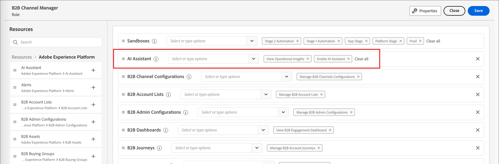

# Habilitar acesso à IA

>[!IMPORTANT]
>
>Se você receber uma mensagem na interface de permissões para informá-lo de que sua organização deve primeiro concordar com termos legais adicionais para obter acesso ao chat do [!DNL Coworker], entre em contato com a equipe de conta da Adobe para obter orientação.

Use a [Interface de Permissões](https://experienceleague.adobe.com/pt-br/docs/experience-platform/access-control/abac/permissions-ui/permissions){target="_blank"} para conceder ou revogar o acesso ao chat do [!DNL Coworker] em sua organização. Para usar o chat do [!DNL Coworker], um determinado usuário deve pertencer a uma função configurada com as permissões _[!UICONTROL Habilitar Assistente de IA]_ e _[!UICONTROL Exibir Insights Operacionais]_.

Como administrador, você pode:

* Adicione a permissão **[!UICONTROL Habilitar Assistente de IA]** a uma determinada função e adicione um usuário a essa função. Esta permissão fornece acesso ao chat do [!DNL Coworker] para usuários em sua organização.

* Adicione a permissão **[!UICONTROL Exibir Insights Operacionais]** a uma determinada função e adicione um usuário a essa função. Essa permissão possibilita que o usuário use os recursos de insights operacionais de chat do [!DNL Coworker].

{width="800" zoomable="yes"}

Use a interface de Permissões para conceder permissões para usar o chat [!DNL Coworker] em [!DNL Adobe Journey Optimizer B2B Edition]. Para obter informações sobre como acessar [!DNL CX Coworker] em [!DNL Adobe Experience Platform] e outros aplicativos do [!DNL Adobe Experience Cloud], consulte a [documentação do CX Enterprise Coworker](https://experienceleague.adobe.com/pt-br/docs/coworker/content/chat/overview){target="_blank"}.

Quando o usuário tiver as permissões necessárias, poderá acessar o chat do [!DNL Coworker] selecionando o ícone de chat _do_[!DNL Coworker] no cabeçalho superior do aplicativo.

Ícone de chat ![[!DNL Coworker] no cabeçalho do aplicativo &#x200B;](./assets/coworker-icon-header.png){width="800" zoomable="yes"}
