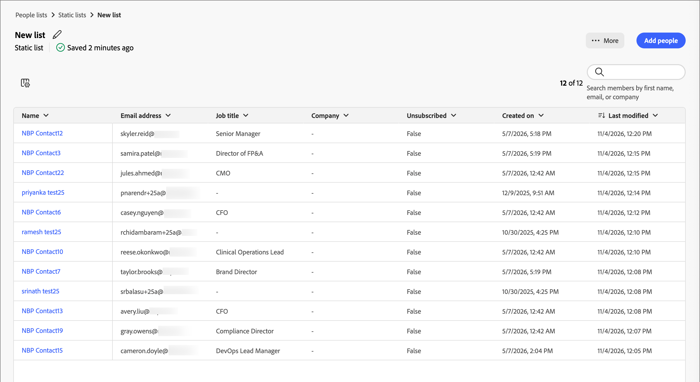

# Listas estáticas de pessoas

Uma [lista de pessoas](./people-lists.md) estática é uma coleção de perfis de pessoas cuja associação é alterada somente quando você adiciona ou remove pessoas. Filtros simples que fazem referência a atributos e atividades de pessoas definem a associação a listas estáticas. A associação é alterada somente quando você adiciona ou remove membros. É possível:

* [Adicione pessoas](#static-list-add-members) aplicando um conjunto de filtros que é avaliado uma vez, quando você o aplica.
* Adicione e remova pessoas por meio de uma conta ou jornada de pessoa, usando as ações [!UICONTROL Adicionar à Lista de Pessoas] e [!UICONTROL Remover da Lista de Pessoas]. (Consulte [Usar listas de pessoas no jornada](./people-lists-journeys.md))
<!-- * [Activate the list to a destination](#static-list-activate) to sync its membership downstream. -->

>[!NOTE]
>
>As definições de filtro de lista estática se aplicam uma vez, quando você adiciona membros à lista. O filtro definido não está disponível posteriormente. Se você quiser manter uma definição de público-alvo consistente usando filtros, use uma [lista dinâmica](./people-lists-dynamic.md).

## Adicionar membros {#static-list-add-members}

>[!NOTE]
>
>Se quiser que uma lista estática comece vazia, não aplique filtros. Uma lista estática vazia é útil quando você planeja adicionar membros por meio de jornadas.

1. Abra a lista estática e clique em **[!UICONTROL Adicionar pessoas]** na parte superior direita.

   {width="700" zoomable="yes"}

1. Na caixa de diálogo _[!UICONTROL Adicionar pessoas]_, defina as regras de qualificação de perfis arrastando os filtros do painel esquerdo.

   Filtrar perfis usando qualquer combinação de:

   * Histórico de atividades
   * Campos de pessoa ativados pelo Experience Platform
   * Campos personalizados
   * Dados de intenção
   * Atributos da pessoa
   * Filtros especiais, como associação de jornada

   Os filtros são aninhados em pastas de categoria. Expanda cada pasta e percorra os filtros disponíveis ou use o campo _Pesquisa_ na parte superior para localizar o filtro necessário. Para cada filtro adicionado:

   * Arraste o filtro do painel esquerdo para o espaço de definição de filtro.
   * Conclua a definição de avaliação de correspondência.
   * Clique em **[!UICONTROL Adicionar restrições]** para refinar os critérios de correspondência.

   Ajuste as condições aplicando a **[!UICONTROL lógica de Filtro]** na parte superior. Você pode optar por corresponder todas as condições, qualquer condição ou definir a lógica avançada.

   {width="800" zoomable="yes"}

1. Clique em **[!UICONTROL Concluído]** para salvar suas alterações.

   O sistema processa a solicitação e exibe uma mensagem de confirmação quando pessoas são adicionadas. O tempo de processamento depende do número de pessoas a serem avaliadas e dos critérios de filtro selecionados. Como a lista continua a ser preenchida, use **[!UICONTROL Atualizar membros]** no menu _[!UICONTROL Mais]_ para atualizar a lista.

   Os membros qualificados aparecem na lista após um breve atraso. O conjunto de filtros é avaliado uma vez, de modo que as pessoas que correspondem aos filtros posteriormente não são adicionadas automaticamente. Você pode repetir esse processo a qualquer momento para adicionar mais pessoas à lista.

   {width="700" zoomable="yes"}

## Remover membros {#static-list-remove-members}

Você pode remover pessoas de uma lista estática automaticamente por meio de uma jornada usando a ação [!UICONTROL Remover da Lista de Pessoas]. (Consulte [Usar listas de pessoas no jornada](./people-lists-journeys.md))

<!--
TODO: Restore this section when the activate to a destination function is released.

## Activate to a destination {#static-list-activate}

Activating a static people list sends its membership to a connected destination, with ongoing sync instead of a one-time export. This is useful for paid media targeting, suppression, and downstream orchestration.

* The static list acts as a container for the people.
* The activation sends and syncs that membership to a destination.
* People added to the list later are propagated automatically.
* People removed later are deactivated automatically.

>[!PREREQUISITES]
>
>You must have one or more configured destinations for your [!DNL Journey Optimizer B2B Edition] sandbox before you can activate a static list to a destination. See [Destinations](./destinations.md).

1. Select the **[!UICONTROL Static lists]** tab.

1. Locate the static list that you want to activate, click the _More menu_ ( **...** ) icon next to the list, and choose **[!UICONTROL Activate to destination]**.

   {width="450"}

   You can also open the static list and use the **[!UICONTROL More]** menu at the top right.

1. Select the check box for the configured destination connection.

   {width="600" zoomable="yes"}

1. Click **[!UICONTROL Save]**.

1. In the _[!UICONTROL Activate list to destination]_ dialog, click **[!UICONTROL Activate]** to confirm.

When activation completes, a confirmation message appears and the destination shows as **[!UICONTROL Active]** on the **[!UICONTROL Destinations]** tab of the list. You can activate a static list to more than one destination at a time. Membership syncs to all of them.

To review the destinations that a static list is activated to, open the list and select the **[!UICONTROL Destinations]** tab.

### Deactivate a destination {#deactivate-destination}

Remove a destination connection from a static list when you no longer want its membership synced downstream.

1. Open the static list and select the **[!UICONTROL Destinations]** tab.

1. Use the row action to remove the destination that you want to disconnect.

1. Confirm in the _[!UICONTROL Deactivate destination]_ dialog.

Deactivating removes the destination from the list. The people in the list are also removed from the connected destination audience.

-->
