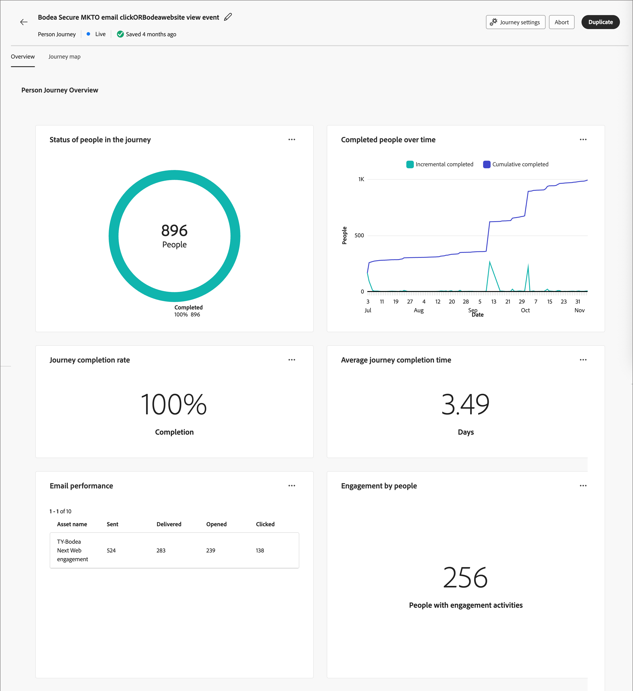

# Detalhes da jornada

Em [!DNL Adobe Journey Optimizer B2B Edition], abra uma jornada de conta ou pessoa publicada e selecione a guia **[!UICONTROL Visão geral]**. Revise o progresso, o engajamento e o desempenho do canal para a jornada selecionada.

As jornadas de conta relatam o progresso das contas. As jornadas de pessoa relatam o progresso das pessoas. Os widgets e rótulos de métrica disponíveis diferem por tipo de jornada. Selecione a guia correspondente para obter detalhes do painel.

Para métricas de email agregadas entre jornadas, use o [Relatório de desempenho de email](../dashboards/email-performance-dashboard.md).

>[!BEGINTABS]

>[!TAB jornadas da conta]

O painel de jornada da conta mostra o progresso da conta, o envolvimento, o desempenho do canal e os resumos da IA gerativa. Leva aproximadamente quatro horas para os dados começarem a preencher os gráficos e as tabelas.

{width="700" zoomable="yes"}

## Conclusão da jornada

Esta seção apresenta duas métricas de conclusão:

* **[!UICONTROL Status das contas na jornada]**: mostra a contagem total de contas e um detalhamento por status de jornada, incluindo _Concluído_, _Em Andamento_ e _Anulado_. Cada segmento exibe um status, porcentagem e contagem de conta.
* **[!UICONTROL Contas concluídas ao longo do tempo]**: mostra o número de contas que concluíram a jornada ao longo do tempo. O eixo horizontal mostra datas e o eixo vertical mostra contagens de conta.

>[!NOTE]
>
>Em jornadas de conta, o gráfico **[!UICONTROL Status de contas na jornada]** inclui contas que passaram pela jornada, mesmo que tenham sido excluídas posteriormente. O **[!UICONTROL drill-through]** exclui contas excluídas, de modo que possa mostrar menos registros do que o gráfico. Essa diferença é esperada. A exclusão de contas não altera as contagens de status de jornada históricas.

## Jornada envolvimento

Esta seção apresenta duas métricas de engajamento:

* **[!UICONTROL Envolvimento por contas]** - Este gráfico de círculo segmenta as contas em uma jornada em _Envolvido_ e _Não envolvido_ categorias. A figura central exibe a contagem total. Essa visualização fornece uma rápida compreensão do envolvimento geral com a conta.
* **[!UICONTROL Participação de pessoas]**: mostra o número de pessoas com atividades de participação na jornada. Esse valor conta pessoas, não atividades de engajamento.

## Desempenho da jornada

Esta seção apresenta duas métricas vitais:

* **[!UICONTROL Taxa de conclusão da Jornada]** - A porcentagem de contas que concluíram com êxito sua jornada.
* **[!UICONTROL Tempo médio de conclusão da jornada]**: o tempo médio que as contas levaram para concluir a jornada, exibido em dias.

## Desempenho do canal {#email-and-sms-performance}

O painel inclui tabelas de **[!UICONTROL desempenho de email]**, **[!UICONTROL desempenho de SMS]** e **[!UICONTROL desempenho de WhatsApp]** para a jornada de conta selecionada. Use as métricas de entrega e envolvimento disponíveis para avaliar cada ponto de contato de comunicação.

Colunas da tabela de **[!UICONTROL Desempenho do email]**:

* _[!UICONTROL Nome do ativo]_ - Nome do ativo
* _[!UICONTROL Enviado]_ - Número de emails enviados
* _[!UICONTROL Taxa de entrega]_ - Número de emails entregues dividido pelo número enviado
* _[!UICONTROL Taxa de Abertura]_ - Número de emails abertos dividido pelo número entregue
* _[!UICONTROL Taxa de click-through]_ - Número de emails clicados dividido pelo número entregue

**[!UICONTROL Colunas da tabela de desempenho de SMS]**:

* _[!UICONTROL Nome do ativo]_ - Nome do ativo
* _[!UICONTROL Enviado]_ - Número de mensagens SMS enviadas
* _[!UICONTROL Taxa de entrega]_ - Número de mensagens SMS entregues dividido pelo número enviado
* _[!UICONTROL Taxa de click-through]_ - Número de mensagens SMS clicadas dividido pelo número entregue
<!--
To generate a shareable PDF of your current view, click **[!UICONTROL Export]** at the top right of the page. 
-->

## Ações adicionais

Use o menu **...** para um gráfico ou tabela para acessar suas ações disponíveis.

### Drill-through

Para o **[!UICONTROL Status de contas no gráfico de jornada]**, escolha **[!UICONTROL Drill-through]** para obter uma análise detalhada dos status de contas individuais.

{width="600" zoomable="yes"}
<!--
The applied global filters are carried over to the view and displayed at the top. Click the _Filter_ icon at the top left to filter the data display by journey.
-->

### Visualizar mais

Escolha **[!UICONTROL Exibir mais]** para acessar os dados estendidos. O pop-up exibido fornece um detalhamento dos dados.

{width="600" zoomable="yes"}

Para baixar os dados, selecione **[!UICONTROL Baixar CSV]**. Para retornar ao painel _[!UICONTROL Visão geral]_, selecione **[!UICONTROL Fechar]**.

>[!TAB jornadas de pessoas]

O painel jornada de pessoa mostra o desempenho de conclusão, engajamento e email das pessoas na jornada selecionada.

{width="700" zoomable="yes"}

## Conclusão da jornada {#person-journey-completion}

Use os gráficos a seguir para revisar o status das pessoas nas tendências de jornada e conclusão:

* **[!UICONTROL Status de pessoas na jornada]**: mostra o número total de pessoas e um detalhamento por status de jornada. Cada segmento exibe um status, porcentagem e contagem de pessoas.
* **[!UICONTROL Pessoas concluídas ao longo do tempo]**: mostra o número de pessoas que concluíram a jornada ao longo do tempo. A série **[!UICONTROL Incremental concluída]** mostra conclusões para cada intervalo de tempo. A série **[!UICONTROL Cumulativo concluído]** mostra o total acumulado de conclusões.

>[!NOTE]
>
>Nas jornadas de pessoas, o gráfico **[!UICONTROL Status de pessoas na jornada]** inclui pessoas que passaram pela jornada, mesmo que tenham sido excluídas posteriormente. **[!UICONTROL O drill-through]** exclui pessoas excluídas, de modo que possa mostrar menos registros do que o gráfico. Essa diferença é esperada. A exclusão de pessoas não altera as contagens de status do histórico de jornadas.

Para o _[!UICONTROL Status de pessoas no gráfico de jornada], clique no ícone de_ Mais_ ( **...** ) e selecione **[!UICONTROL Fazer drill-through]** para examinar status de pessoas individuais.

## Jornada envolvimento {#person-journey-engagement}

O widget **[!UICONTROL Envolvimento por pessoas]** mostra o número de pessoas com atividades de engajamento na jornada. Esse valor conta pessoas, não atividades de engajamento.

## Desempenho da jornada {#person-journey-performance}

Use as seguintes métricas para analisar o desempenho de conclusão:

* **[!UICONTROL Taxa de conclusão da Jornada]**: a porcentagem de pessoas que concluíram a jornada.
* **[!UICONTROL Tempo médio de conclusão da jornada]**: o tempo médio que as pessoas levaram para concluir a jornada, exibido em dias.

## Desempenho do email {#person-journey-email-performance}

A tabela **[!UICONTROL Desempenho do email]** mostra contagens para cada ativo de email na jornada de pessoa selecionada, em vez de taxas:

* **[!UICONTROL Nome do ativo]**: nome do ativo de email
* **[!UICONTROL Enviado]**: Número de emails enviados
* **[!UICONTROL Entregues]**: número de emails entregues
* **[!UICONTROL Abertos]**: Número de emails abertos
* **[!UICONTROL Clicados]**: Número de emails clicados

>[!ENDTABS]
