# Dividir e mesclar caminhos {#split-paths}

Use os nós de caminho de divisão e intercalação para segmentar pessoas ou contas de acordo com as condições definidas. Crie caminhos para a lista de público ou contas de acordo com as condições, defina cada caminho com nós de ação e evento para o segmento, depois combine os caminhos e continue a jornada.

{width="30"} [Assista ao vídeo de visão geral](#overview-video)

Um nó _Split paths_ define um ou mais caminhos segmentados com base em **_account_** ou filtros de pessoas. Uma divisão baseada em um filtro de pessoas é fechada automaticamente com um nó de caminhos de mesclagem para que todas as pessoas possam avançar para a próxima etapa sem perder o contexto da conta.

>[!NOTE]
>
>Há suporte para, no máximo, 25 caminhos.

## Dividir caminhos por contas {#split-paths-by-accounts}

**_(Somente jornadas de Conta)_**

Dividir por caminhos de contas pode incluir ações e eventos de contas e pessoas. Esses caminhos podem ser divididos ainda mais.

_&#x200B;**Como funciona um caminho dividido por nó de contas**&#x200B;_

* Cada caminho adicionado inclui um nó final com a capacidade de adicionar nós a cada borda.
* Os nós divididos por conta podem ser aninhados (você pode dividir o caminho por contas repetidamente).
* A avaliação de cada caminho é de cima para baixo. Se uma conta corresponder ao primeiro e ao segundo caminhos, ela continuará somente pelo primeiro caminho.
* Dois ou mais caminhos podem ser combinados usando um nó de mesclagem.
* O nó oferece suporte à definição de um caminho _[!UICONTROL Outras contas]_, em que você pode adicionar ações ou eventos para contas que não correspondam a um dos segmentos/caminhos definidos.

Nó do 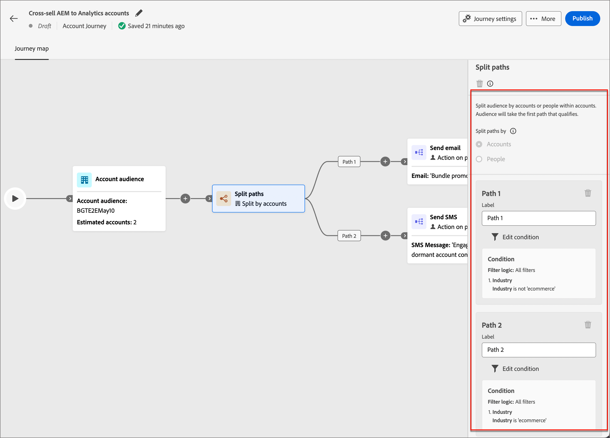{width="700" zoomable="yes"}

### Condições de caminho da conta {#account-path-filters}

| Condições de caminho | Descrição |
| --------------- | ----------- |
| [!UICONTROL Atributos da conta] | Atributos do perfil da conta, incluindo: <li>Receita anual <li>Cidade <li>País <li>Tamanho do funcionário <li>Setor <li>Nome <li>Código SIC <li>Estado |
| [!UICONTROL Objetos Personalizados] > Tem `<custom object>` | [!BADGE Beta]{type=Informative tooltip="Recurso do Beta"} A conta tem ou não registros de esquema relacional. Ele também pode ser avaliado em relação a qualquer um dos critérios de objeto personalizado selecionado, conforme configurado no [esquema relacional XDM](../admin/xdm-field-management.md#relational-schemas). (Consulte [Filtragem de dados personalizada](#custom-data-filtering).) |
| [!UICONTROL Filtros especiais] > [!UICONTROL A conta corresponde ao grupo de compras] | A conta corresponde a um ou mais grupos de compra. Ele pode ser avaliado em relação a uma ou mais das seguintes restrições para um grupo de compras correspondente: <li>Interesse da solução <li>Estágio do Grupo de Compras <li>Status do Grupo de Compras <li>Pontuação de envolvimento <li>Pontuação de integridade <li> Número de pessoas na função de grupo de compra |

### Adicionar um caminho dividido pelo nó da conta

1. Navegue até o mapa de jornadas.

1. Clique no ícone de adição ( **+** ) em um caminho e escolha **[!UICONTROL Dividir caminhos]**.

   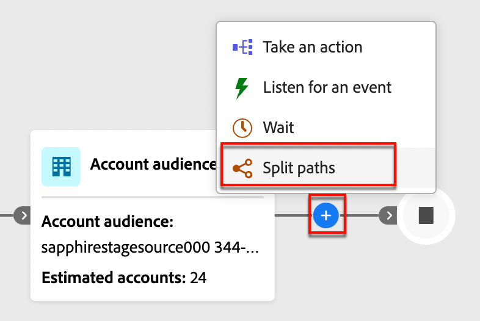{width="300" zoomable="no"}

1. Nas propriedades do nó à direita, escolha **[!UICONTROL Contas]** para a divisão.

1. Para definir uma condição aplicável ao _[!UICONTROL Caminho 1]_, clique em **[!UICONTROL Aplicar condição]**.

   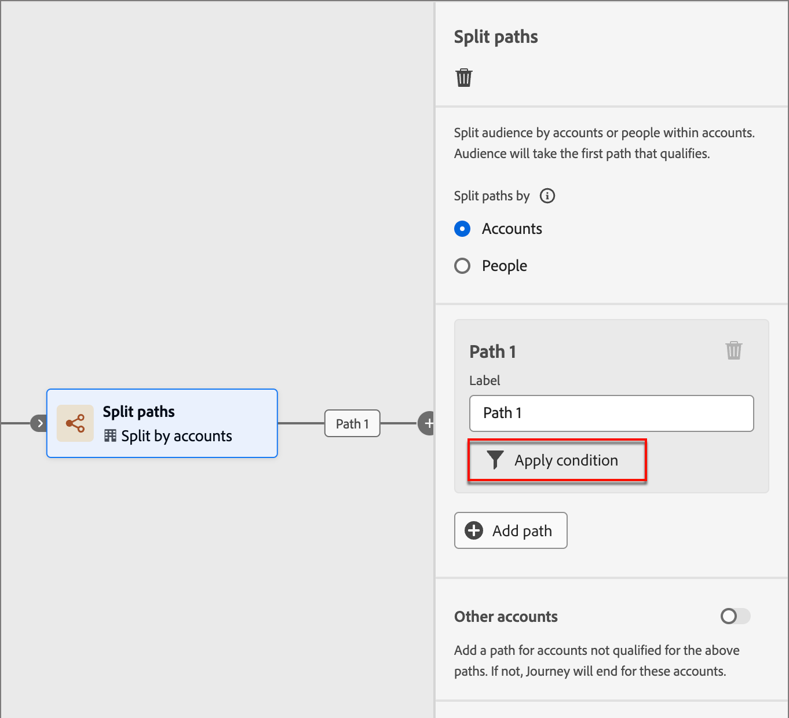{width="500" zoomable="yes"}

1. Para definir o caminho dividido, adicione um ou mais filtros no editor de condições.

   * Arraste e solte atributos de filtro da navegação à esquerda e conclua a definição de correspondência.

   * Refine suas condições aplicando a **[!UICONTROL lógica de Filtro]** na parte superior. Você escolhe corresponder todos os filtros ou qualquer filtro.

     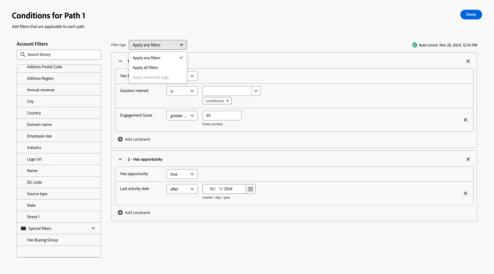{width="700" zoomable="yes"}

   * Clique em **[!UICONTROL Concluído]**.

1. Para adicionar mais caminhos, clique em **[!UICONTROL Adicionar caminho]** e repita as etapas anteriores para adicionar condições aplicáveis a este caminho.

   Você também pode rotular cada caminho com base nessas condições ou usar os rótulos padrão.

1. Se necessário, reordene os caminhos de acordo com a prioridade desejada para a divisão.

   A filtragem de caminho é avaliada em ordem decrescente. Cada conta continua pelo primeiro caminho correspondente.

   Clique nas setas para cima e para baixo na parte superior direita de cada cartão de caminho para movê-lo para cima ou para baixo na lista de caminhos.

   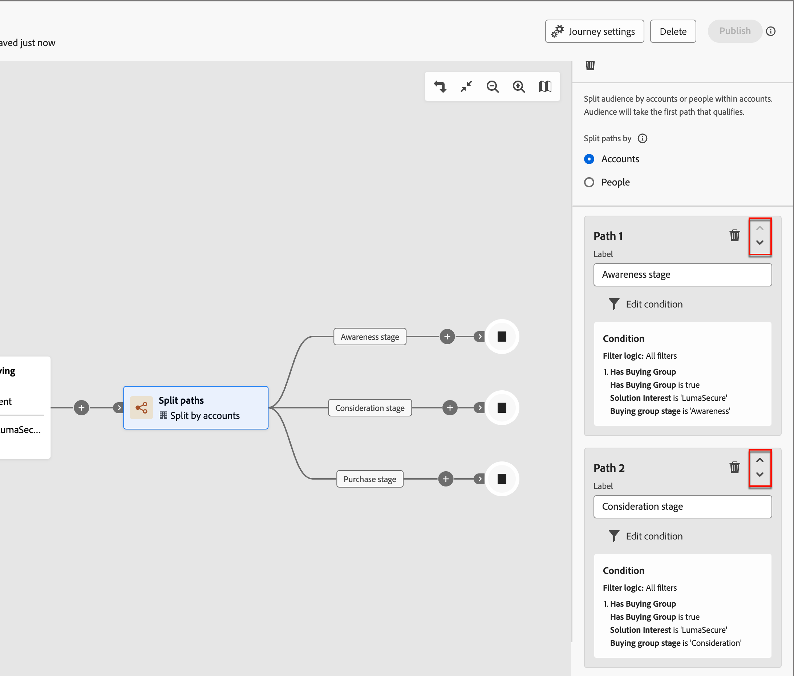{width="500" zoomable="yes"}

1. Habilite a opção **[!UICONTROL Outras contas]** para definir o caminho padrão para contas que não correspondem aos segmentos/caminhos definidos.

   Quando essa opção não está ativada, a jornada termina para contas que não correspondem a um segmento/caminho definido na divisão.

### Filtragem de grupo de compras para contas {#buying-group-filtering-accounts}

Você pode definir um caminho para contas associadas a grupos de compra e filtrar o caminho usando critérios de grupo de compra. Use o filtro **[!UICONTROL A conta corresponde ao grupo de compras]** para definir o segmento de caminho usando um grupo de compras correspondente. Esse filtro também inclui a opção para identificar contas com base no número de funções atribuídas em um grupo de compras correspondente.

Por exemplo, avalie a prontidão do grupo de compras com base na profundidade (número de pessoas) que ele tem em diferentes funções, como três tomadores de decisão e dois influenciadores. Nesse caso, defina a condição para direcionar contas com um mínimo de três (3) tomadores de decisão e dois (2) influenciadores em um grupo de compras correspondente:

1. Clique em **[!UICONTROL Adicionar filtro]** e escolha o filtro **[!UICONTROL Número de pessoas na função de grupo de compras]**.

   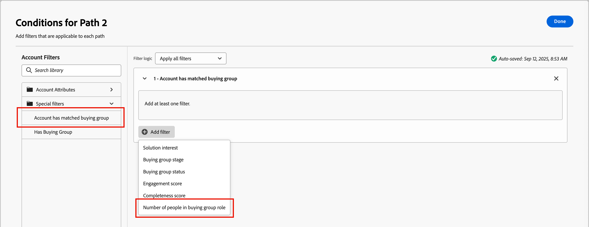{width="700" zoomable="yes"}

1. Defina o primeiro parâmetro de função.

   * Defina a avaliação de número de pessoas como `at least` com um valor de `3`.
   * Defina a avaliação de função como `is` e escolha `Decision Maker` na lista de funções.

1. Repita a etapa 1 para adicionar outro parâmetro de função de grupo de compra.

1. Defina o segundo parâmetro de função.

   * Defina a avaliação de número de pessoas como `at least` com um valor de `2`.
   * Defina a avaliação de função como `is` e escolha `Influencer` na lista de funções.

   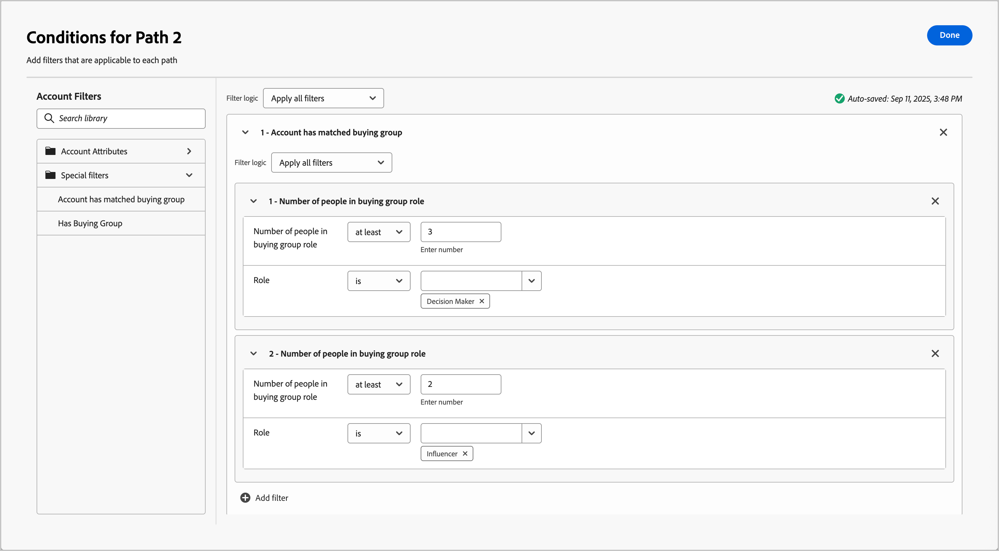{width="700" zoomable="yes"}

1. Clique em **[!UICONTROL Concluído]** quando tiver todas as condições definidas para o caminho.

Para atualizar o status do grupo de compras ou do estágio para as contas identificadas, adicione um nó de ação no caminho.

## Dividir caminhos por pessoas

_(jornadas de conta e pessoa)_

Dividir por caminhos de pessoas pode incluir apenas ações de pessoas. Esses caminhos não podem ser divididos novamente e se unem automaticamente.

_&#x200B;**Como funciona um caminho dividido por nó de pessoas**&#x200B;_

* Divisão por nós de pessoas em uma combinação de divisão de mesclagem de _nó agrupado_. Os caminhos divididos se mesclam automaticamente para que todas as pessoas possam avançar para a próxima etapa sem perder o contexto da conta.
* Os nós Split by people não podem ser aninhados (não é possível adicionar um caminho dividido para pessoas em um caminho que esteja neste nó agrupado).
* A avaliação de cada caminho é de cima para baixo. Se uma pessoa corresponder ao primeiro e ao segundo caminhos, ela continuará somente pelo primeiro caminho.
* O nó oferece suporte ao uso de _relações conta-pessoa_, que permitem filtrar pessoas com base em sua função (como contratante ou funcionário em tempo integral), conforme definido na relação.
* O nó oferece suporte à definição de um caminho _[!UICONTROL Outras pessoas]_, em que você pode adicionar ações ou eventos para pessoas que não correspondem a um dos segmentos/caminhos definidos.

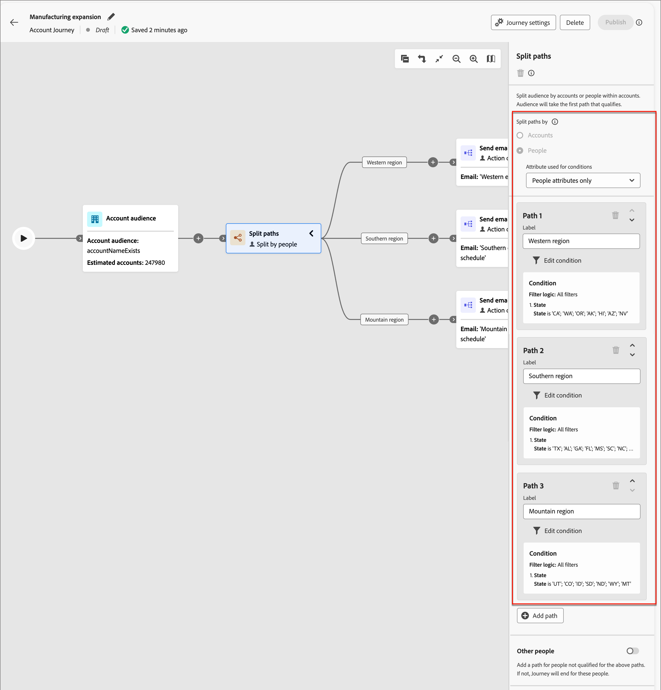{width="700" zoomable="yes"}

### Filtros de caminho de pessoas {#people-path-filters}

| Filtros | Descrição |
| ------------ | ----------- |
| [!UICONTROL Objetos Personalizados] > Tem `<custom object>` | [!BADGE Beta]{type=Informative tooltip="Recurso do Beta"} A pessoa tem ou não registros de esquema relacional. Ele também pode ser avaliado em relação a qualquer um dos critérios de objeto personalizado selecionado, conforme configurado no [esquema relacional XDM](../admin/xdm-field-management.md#relational-schemas). (Consulte [Filtragem de dados personalizada](#custom-data-filtering)) |
| [!UICONTROL Histórico de eventos] | Divide as pessoas com base nos eventos de experiência ocorridos antes da entrada da jornada. Expanda a pasta para ver todos os tipos de evento configurados em [Admin > Configuração de evento XDM](../admin/configure-aep-events.md) e selecione um para adicionar como filtro. As restrições incluem campos do evento selecionado, uma janela de tempo de lookback medida a partir de quando a pessoa informa a jornada e um número mínimo opcional de vezes. |
| [!UICONTROL Atributos da pessoa] | Atributos do [perfil de pessoa](../admin/field-mapping.md#xdm-business-person-attributes), incluindo: <li>Cidade <li>País <li>Endereço de e-mail <li>Email inválido <li>Email suspenso <li>Nome <li>Região inferida <li>Nome do cargo <li>Sobrenome <li>Número do celular <li>Pontuação de engajamento de pessoa <li>Número de telefone <li>Código postal <li>Estado |
| [!UICONTROL Filtros especiais] > [!UICONTROL Membro do Grupo de Compras] | A pessoa é ou não é um membro do grupo de compra avaliado em relação a um ou mais dos seguintes critérios: <li>Interesse da solução</li><li>Status do Grupo de Compras</li><li>Pontuação de integridade</li><li>Pontuação de engajamento</li><li>Foi removido (padrão: `false`)</li><li>Função</li> (Consulte [Filtragem de associação](#membership-filtering)) |
| [!UICONTROL Filtros especiais] > [!UICONTROL Membro do público-alvo do perfil] | A pessoa é ou não é membro de um ou mais públicos-alvo de perfil do [!DNL Adobe Experience Platform]. (Consulte [Filtragem de associação](#membership-filtering)) |

### Condições de caminho conta-pessoa

| Condições de caminho | Descrição |
| --------------- | ----------- |
| [!UICONTROL Função na conta] | Uma função na conta é atribuída ou não à pessoa. Restrições opcionais: <li>Nome da função |

### Adicionar um caminho dividido pelo nó de pessoas {#add-a-split-path-by-people-node}

>[!NOTE]
>
>Quando você divide caminhos por pessoas, um nó _Fechar caminhos divididos_ é inserido automaticamente para encerrar a divisão. Um caminho dividido por pessoas permite somente _Realizar uma ação_ em nós de pessoas.

1. Navegue até o mapa de jornadas.

1. Clique no ícone de adição ( **+** ) em um caminho e escolha **[!UICONTROL Dividir caminhos]**.

   {width="300" zoomable="no"}

1. Nas propriedades do nó à direita, escolha **[!UICONTROL Pessoas]** para a divisão.

1. (Somente jornadas de conta) Defina os **[!UICONTROL Atributos usados para as condições]**.

   * Escolha **[!UICONTROL Somente atributos de pessoas]** para usar condições relacionadas ao perfil de pessoa.
   * Escolha **[!UICONTROL Somente atributos Conta-Pessoa]** para usar condições relacionadas à associação de função da pessoa em uma conta.

1. Para definir uma condição aplicável ao _[!UICONTROL Caminho 1]_, clique em **[!UICONTROL Aplicar condição]**.

1. Para definir o caminho dividido, adicione um ou mais filtros no editor de condições.

   * Arraste e solte qualquer um dos filtros de pessoas da navegação à esquerda e conclua a definição de correspondência.

     >[!NOTE]
     >
     >Se você tiver campos de pessoa personalizados definidos no esquema de público-alvo da conta na Experience Platform, esses campos também estarão disponíveis para uso como atributos de pessoa nas condições.

   * Refine suas condições aplicando a **[!UICONTROL lógica de Filtro]** na parte superior. Você escolhe corresponder todas as condições de atributo ou qualquer condição.

     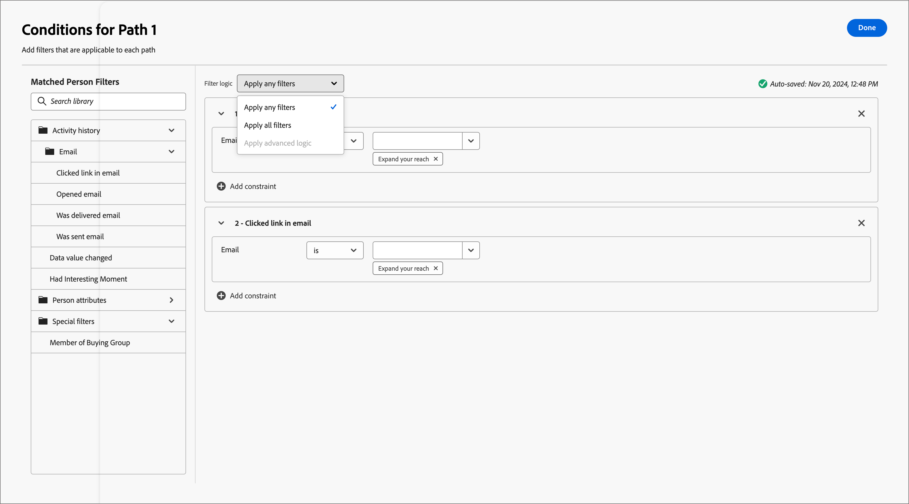{width="700" zoomable="yes"}

   * Clique em **[!UICONTROL Concluído]**.

1. Para adicionar mais caminhos, clique em **[!UICONTROL Adicionar caminho]** e repita as etapas anteriores para adicionar condições aplicáveis a este caminho.

   Você também pode rotular cada caminho com base nessas condições ou usar os rótulos padrão.

1. Se necessário, reordene os caminhos de acordo com a prioridade desejada para a divisão.

   A filtragem de caminho é avaliada em ordem decrescente. Cada pessoa continua pelo primeiro caminho que corresponde a.

   Clique nas setas para cima e para baixo na parte superior direita de cada cartão de caminho para movê-lo para cima ou para baixo na lista de caminhos.

   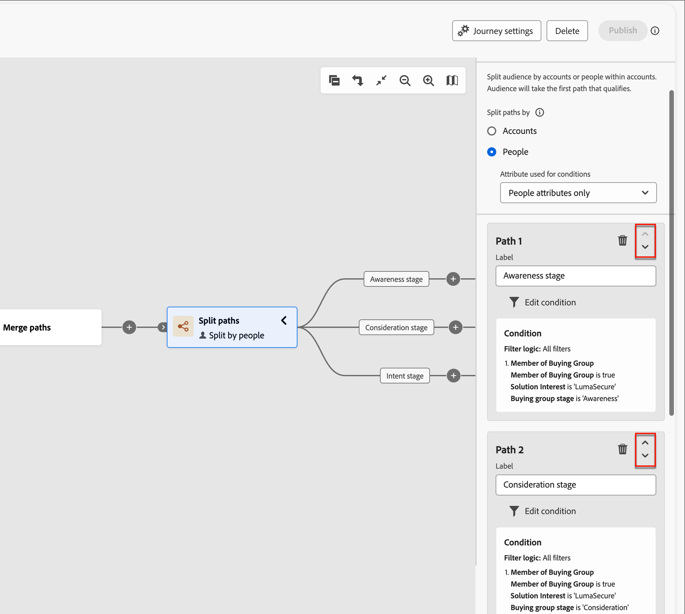{width="500" zoomable="yes"}

1. Habilite a opção **[!UICONTROL Outras pessoas]** para adicionar um caminho padrão para pessoas que não correspondam aos caminhos definidos.

   Quando essa opção não está ativada, as pessoas que não correspondem a um segmento/caminho definido passam pela divisão e avançam para a próxima etapa da jornada.

   Quando você tem condições definidas para cada caminho para dividir o público no nível das pessoas, é possível adicionar ações que deseja realizar nas pessoas.

### Filtragem do histórico de eventos de experiência {#experience-event-history-filtering}

Para um caminho dividido por pessoas, você pode definir um caminho com base nos eventos de experiência que ocorreram antes da pessoa entrar na jornada. Para ver uma lista de todos os tipos de eventos configurados pelo administrador, expanda a pasta **[!UICONTROL Histórico de eventos]** no editor de condições. Selecione um tipo de evento para adicioná-lo como uma condição de filtro.

A janela de tempo do histórico de eventos é medida retroativamente a partir do momento em que a pessoa entra na jornada. Por exemplo, uma janela de 30 dias avalia se o evento de qualificação ocorreu nos 30 dias anteriores à entrada da jornada.

É possível refinar ainda mais o filtro usando restrições específicas aos campos do evento selecionado. As restrições opcionais de **[!UICONTROL Número mínimo de vezes]** e **[!UICONTROL Data da atividade]** são avaliadas na janela de pesquisa definida. Como os dados do histórico de eventos são sincronizados de [!DNL Adobe Experience Platform], pode haver um breve atraso antes que um evento recente se torne disponível para este filtro.

>[!NOTE]
>
>As [Configurações de eventos de experiência e campos](../admin/configure-aep-events.md) determinam os eventos disponíveis na pasta [!UICONTROL Histórico de eventos].

**Exemplo:** para encaminhar as pessoas que clicaram em um link em um email de marketing antes de entrar na jornada, selecione o evento de clique de email na pasta [!UICONTROL Histórico de eventos], defina a janela de pesquisa e aplique restrições no nível do campo, conforme necessário.

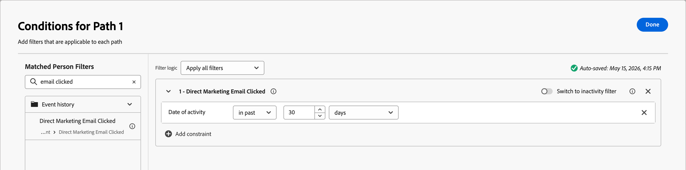{width="700" zoomable="yes"}

>[!BEGINSHADEBOX &quot;Filtragem de inatividade&quot;]

Para cada um dos filtros do _[!UICONTROL Histórico de eventos]_, você pode habilitar a opção **[!UICONTROL Alternar para filtro de inatividade]**. Essa opção altera o filtro para uma avaliação de ausência desse tipo de atividade. Para criar um caminho para as pessoas que _&#x200B;**não**&#x200B;_ abriram um email, adicione o filtro _[!UICONTROL Email de Marketing Direto Aberto]_. Ative a opção de inatividade e especifique o email.

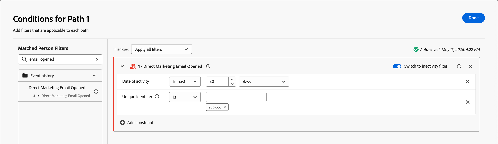{width="700" zoomable="yes"}

>[!ENDSHADEBOX]

### Filtragem de associação {#membership-filtering}

Na seção _[!UICONTROL Filtros especiais]_, use os filtros a seguir para criar caminhos com base na associação de uma pessoa:

* _[!UICONTROL Membro do Grupo de Compras]_ - Avalia se a pessoa é membro de um grupo de compras.
* _[!UICONTROL Membro do Público-alvo do Perfil]_ - Avalia se a pessoa é membro de um público-alvo de perfil [!DNL Adobe Experience Platform].

Para adicionar um filtro de associação, arraste-o da pasta _[!UICONTROL Filtros especiais]_ para o espaço de trabalho de condições e defina a associação como _true_ para incluir membros ou _false_ para excluí-los. Você pode combinar ambos os filtros na mesma condição de caminho e usar a **[!UICONTROL Lógica do filtro]** para corresponder a qualquer um ou todos eles.

Esses filtros também estão disponíveis quando você [adiciona filtros para um evento](./listen-for-event-nodes.md#membership-filtering) em um nó _Ouvir um evento_.

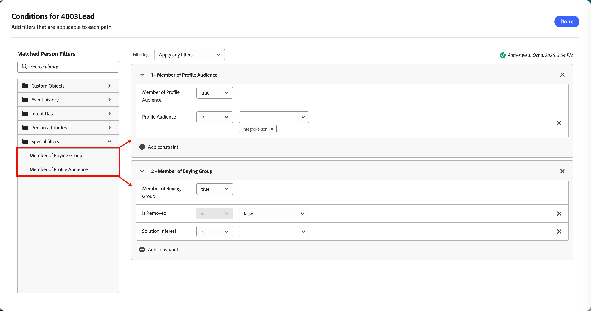{width="700" zoomable="yes"}

**Membro do Grupo de Compras**

Por exemplo, para criar um caminho para membros de grupos de compra com uma função específica, defina a associação como _true_ e selecione um _[!UICONTROL Interesse da solução]_ associado aos grupos de compra.

Ao adicionar o filtro, o sistema inclui a restrição _[!UICONTROL É removido]_ por padrão e a define como `false`, de modo que o caminho inclui somente membros atuais do grupo de compra.

Clique em **[!UICONTROL Adicionar restrição]** para incluir restrições adicionais de associação de grupo de compra:

* _[!UICONTROL Estágio de grupo de compras]_
* _[!UICONTROL Status do grupo de compras]_
* _[!UICONTROL Pontuação de integridade]_
* _[!UICONTROL Pontuação de engajamento]_
* _[!UICONTROL Função]_

>[!IMPORTANT]
>
>A restrição _[!UICONTROL Is Removed]_ determina se os membros do grupo de compra removidos são avaliados:
>
>* `false` (padrão) - Retorna somente os membros atuais do grupo de compras. Membros removidos não são incluídos.
>* `true` - Retorna somente membros de grupos de compra removidos. Os membros atuais não estão incluídos.
>* Restrição removida - Retorna os membros do grupo de compra atuais e removidos.
>
>Se você remover a restrição, o caminho poderá incluir pessoas que não estão mais no grupo de compra.

**Membro do Público-Alvo do Perfil**

Use a restrição _[!UICONTROL Público-alvo do Perfil]_ para selecionar um ou mais públicos-alvo. Por exemplo, se você selecionar o público-alvo `integroPerson`, o caminho qualificará todas as pessoas que eram membros desse público-alvo quando ocorreu a última assimilação em lote.

>[!NOTE]
>
>O filtro não calcula a associação de público-alvo em tempo real. Qualifica as pessoas com base em sua associação no público selecionado a partir da última assimilação de público em lote. Somente os públicos-alvo que foram assimilados em [!DNL Journey Optimizer B2B Edition] podem ser avaliados.

## Filtragem de dados personalizada {#custom-data-filtering}

[!BADGE Beta]{type=Informative tooltip="Recurso do Beta"}

Você pode usar esquemas relacionais (classes baseadas em modelo) para dividir caminhos por conta ou pessoas. Os objetos personalizados são definidos em _esquemas relacionais_, e um administrador de produto pode [configurar campos de esquemas relacionais](../admin/xdm-field-management.md#relational-schemas) em [!DNL Journey Optimizer B2B Edition]. Os campos de esquema selecionados estão disponíveis no editor de condições para uso nos nós _caminho dividido por conta_ e _caminho dividido por pessoas_.

Para uma condição **[!UICONTROL Dividir caminho por conta]** ou **[!UICONTROL Dividir caminho por pessoas]**, expanda _[!UICONTROL Objetos Personalizados]_. Adicione a condição e defina o valor como `true` ou `false`. Clique em **[!UICONTROL Adicionar restrição]** para usar os valores de campo para filtragem.

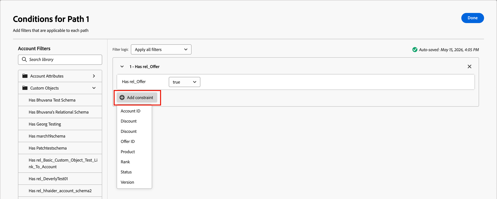{width="600" zoomable="yes"}

## Mesclar caminhos {#merge-paths}

Para combinar diferentes caminhos de _divisão por conta_ em sua jornada, adicione um nó _Caminhos de mesclagem_.

1. Em um mapa de jornadas com um nó dividido que tem três ou mais caminhos, adicione uma combinação de ações e eventos a cada caminho.

1. Clique no ícone de adição ( **+** ) de qualquer um desses caminhos e escolha **[!UICONTROL Mesclar]** nas opções exibidas.

   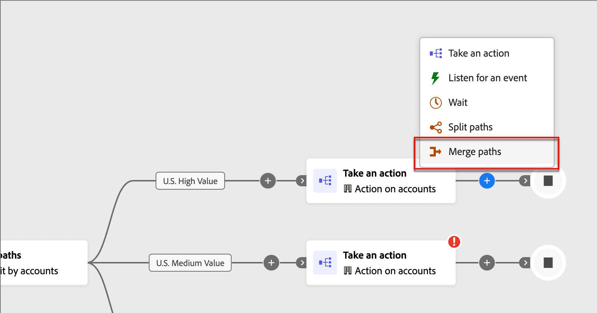{width="400" zoomable="no"}

1. Nas propriedades do nó dos caminhos de mesclagem, selecione os caminhos que deseja mesclar.

   Nó do 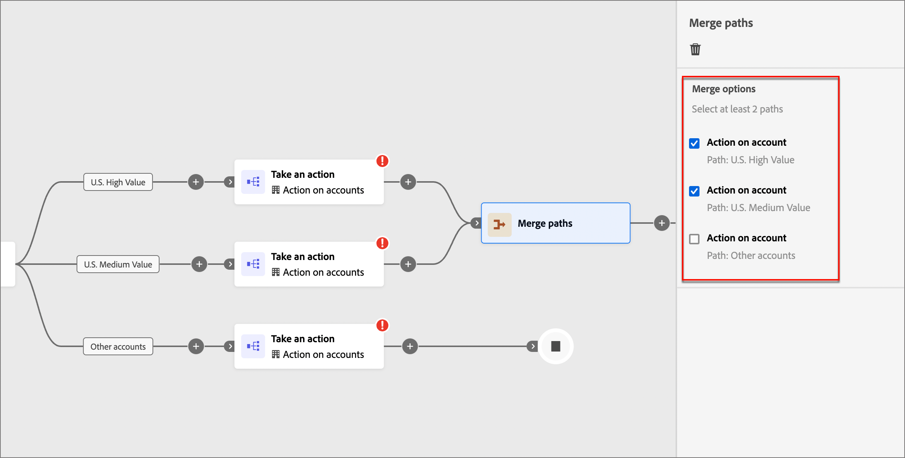{width="600" zoomable="yes"}

   Os caminhos são mesclados para que as contas dos caminhos selecionados sejam combinadas em um único caminho que possa continuar a avançar pela jornada.

1. Se necessário, você pode desfazer a mesclagem de caminhos navegando de volta para as propriedades do nó dos caminhos de mesclagem e desmarcando a caixa de seleção de todos os caminhos que deseja remover.

## Vídeo de visão geral {#overview-video}

>[!VIDEO](https://video.tv.adobe.com/v/3443261/?captions=por_br&learn=on)
